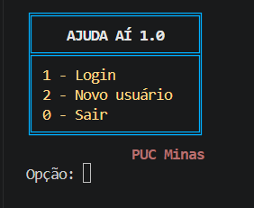
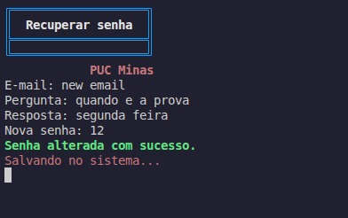
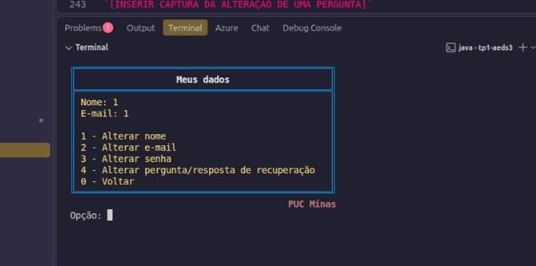
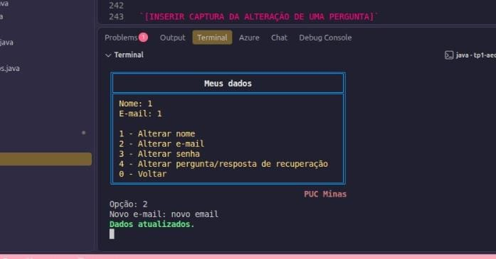
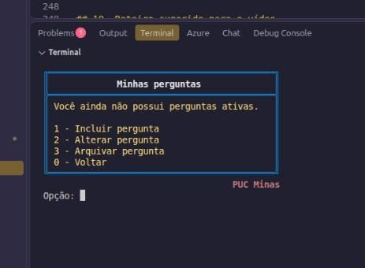
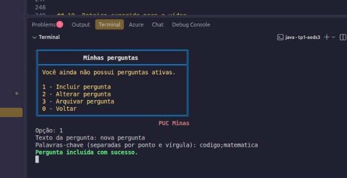
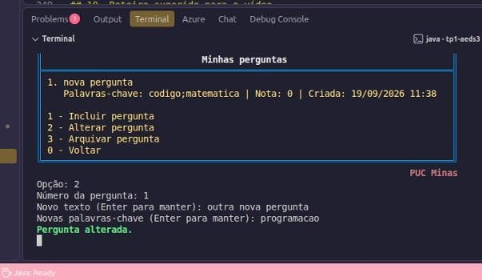
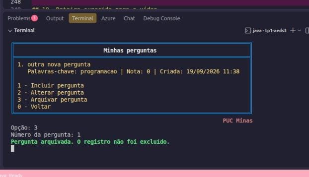

# Relatório dos Trabalhos Práticos — AEDS III


### Sistema Ajuda Aí 1.0


### Participantes


| Nome completo | Matrícula |

| --- | --- |

| Ana Flávia Menezes de Almeida | 8976988 |

| Clarisse de Assis Pereira | 903541 |

| Eduardo Borges de Souza | 890309 |

| Rian Chaves Pimenta | 898910 |


- **Turma:** (8203100) Algoritmos e Estruturas de Dados III

- **Professor:** Marcos André Silveira Kutova

- **Repositório do projeto:** [INSERIR URL DO REPOSITÓRIO EXCLUSIVO DO AJUDA AÍ]

- **Vídeo de demonstração (TP3):** [INSERIR LINK DO VÍDEO DO TP3]


## 1. Descrição do trabalho


O Ajuda Aí 1.0 é um sistema de perguntas desenvolvido em Java, com interface de texto e armazenamento em arquivos binários. Nesta primeira etapa foram trabalhados o cadastro e a autenticação de usuários, a recuperação de senha e o gerenciamento das perguntas do usuário que está conectado.


Após o login, o usuário pode consultar e alterar seus dados, incluir perguntas, listar suas perguntas ativas, alterar o texto e as palavras-chave de uma pergunta e arquivá-la. As áreas de respostas, votos e busca global aparecem no menu, mas foram deixadas para etapas posteriores, conforme previsto no enunciado.


Os dados não dependem de um banco de dados externo. Usuários, perguntas e índices são gravados em arquivos binários no diretório `data`. Quando o programa é iniciado, esses arquivos são abertos e os índices são reconstruídos a partir dos registros válidos.


## 2. Funcionalidades implementadas


### 2.1 Cadastro de usuário


O cadastro solicita nome, e-mail, senha, pergunta secreta e resposta secreta. O e-mail é convertido para letras minúsculas e tem os espaços das extremidades removidos antes de ser pesquisado ou gravado. Isso impede, por exemplo, que `Aluno@Email.com` e `aluno@email.com` sejam tratados como contas diferentes.


Antes da gravação, o sistema consulta o índice de e-mails. Caso encontre outra conta com o mesmo endereço, apresenta a mensagem `E-mail já cadastrado.`. Os IDs são inteiros positivos e gerados automaticamente pelo CRUD.


**Observação:** a tela atual lê todos os campos e só depois verifica se o e-mail já existe. O enunciado sugere verificar o e-mail antes de solicitar os demais dados.


### 2.2 Login e recuperação de senha


O login pesquisa o usuário pelo e-mail e compara o hash da senha informada com o hash armazenado. Quando o login falha, o sistema permite tentar novamente, recuperar a senha ou voltar ao menu anterior.


Na recuperação, a pergunta secreta cadastrada é apresentada. A resposta é normalizada antes do cálculo do hash: seus espaços externos e acentos são removidos e as letras são transformadas em minúsculas. Assim, respostas como `São Paulo` e `sao paulo` produzem o mesmo resultado. Se a resposta estiver correta, uma nova senha pode ser cadastrada.


As senhas e respostas secretas não são armazenadas como texto. O programa grava somente seus hashes SHA-256.


### 2.3 Alteração dos dados do usuário


Na opção **Meus dados**, podem ser alterados:


- nome;

- e-mail;

- senha;

- pergunta e resposta de recuperação.


A alteração de e-mail exige uma operação especial. O método `BancoDados.atualizarUsuario` normaliza e verifica o novo endereço, atualiza o registro do usuário, remove a entrada do e-mail antigo da tabela hash e inclui a entrada do novo e-mail apontando para o mesmo ID. O ID do usuário não é alterado.


### 2.4 Cadastro e vínculo das perguntas


Uma pergunta armazena os seguintes campos:


- `idPergunta`: identificador sequencial e único no sistema;

- `idUsuario`: identificador do autor;

- `criacao`: data e hora de criação em milissegundos;

- `alteracao`: data e hora da última alteração em milissegundos;

- `nota`: soma dos votos, iniciada em zero;

- `pergunta`: texto da pergunta;

- `palavrasChave`: termos separados por ponto e vírgula;

- `ativa`: indica se a pergunta está ativa ou arquivada.


Ao incluir uma pergunta pela interface, o programa usa automaticamente o ID do usuário conectado. O construtor também preenche as datas de criação e alteração, define a nota como zero e marca a pergunta como ativa.


### 2.5 Listagem e alteração das perguntas


A listagem consulta o índice que relaciona o ID do usuário aos IDs de suas perguntas. O menu mostra uma numeração temporária, iniciada em 1, sem expor os IDs internos. A data é apresentada no formato `dd/MM/yyyy HH:mm`.


Para alterar uma pergunta, o usuário escolhe essa numeração. O sistema recupera o objeto correspondente, permite alterar texto e palavras-chave e atualiza o campo `alteracao` com o horário atual.


### 2.6 Arquivamento


O arquivamento não apaga fisicamente o registro. O método `Menu.arquivarPergunta` muda `ativa` para `false`, atualiza a data de alteração e chama `BancoDados.atualizarPergunta`. O CRUD marca a versão anterior com uma lápide e acrescenta a versão atualizada ao final do arquivo.


O sistema não oferece uma opção de desarquivamento, portanto o procedimento é definitivo pela interface atual.


**Limitação conhecida:** a consulta `perguntasDoUsuario` filtra as perguntas inativas. Por esse motivo, uma pergunta arquivada deixa de aparecer até para seu autor, enquanto o enunciado pede que ela continue visível ao autor com a indicação `ARQUIVADA`.


## 3. Organização das classes


### 3.1 Inicialização e interface


- **`Main`**: define o diretório dos dados, abre o banco e inicia o menu.

- **`App`**: ponto de entrada mantido para executar `Main` pelo Maven.

- **`Menu`**: controla as telas, lê as opções e coordena cadastro, login, recuperação, edição de dados e gestão de perguntas.


### 3.2 Entidades


- **`Usuario`**: representa o usuário e implementa `aed3.InterfaceRegistro` (`serialize`/`deserialize`, `getId`/`setId`).

- **`Pergunta`**: representa a pergunta, seus metadados, seu autor e seu estado de arquivamento; também implementa `aed3.InterfaceRegistro`.


### 3.3 Persistência e índices (classes do professor, pacote `aed3`)


- **`Arquivo<T>`**: CRUD fornecido na disciplina. Grava lápide, indicador de tamanho em `short` e o vetor de bytes, e mantém o índice direto ID → endereço em uma **Tabela Hash Extensível** (`HashExtensivel<ParIDEndereco>`).

- **`HashExtensivel<T>`**: tabela hash extensível com diretório e cestos gravados em disco.

- **`ArvoreBMais<T>`**: Árvore B+ real (páginas, divisão de páginas e ligação entre folhas).

- **`ParIdId`**: par `(idUsuario, idPergunta)` guardado na Árvore B+ do relacionamento 1:N.

- **`ParEmailId`** (`br.pucminas.persistence`): adaptação do `ParNomeId` do professor, com campo de 60 bytes, usada como índice indireto e-mail → ID do usuário na Árvore B+.

- **`BancoDados`**: concentra os dois arquivos de dados, os índices e as regras que envolvem mais de um arquivo.


Nós acrescentamos um construtor extra em `Arquivo`, que recebe a pasta base dos dados (o original grava sempre em `./dados`). Isso permite usar pastas temporárias nos testes; o construtor original continua existindo. No TP3, também acrescentamos `AutoCloseable` e `close()` à cópia Maven de `ListaInvertida`, para fechar os arquivos do dicionário e dos blocos. Nós mantivemos os algoritmos de armazenamento fornecidos na disciplina.


### 3.4 Segurança


- **`Seguranca`**: calcula hashes SHA-256, normaliza respostas secretas e compara a senha informada com o hash gravado.


### 3.5 Testes


- **`BancoDadosTest`** (em `src/test/java`): persistência de usuários e perguntas, alteração, arquivamento, listagem com e sem arquivadas, recusa de pergunta com usuário inexistente, carga de 25 perguntas para forçar a divisão de páginas da Árvore B+ e reabertura do banco.

- **`AppTest`**: teste básico gerado pelo modelo inicial do Maven.


## 4. Estrutura dos arquivos


As entidades convertem seus campos para vetores de bytes com `DataOutputStream` e fazem o caminho inverso com `DataInputStream`.


Cada registro no arquivo de dados contém:


1. uma lápide de um byte, que informa se o registro está ativo ou excluído;

2. o tamanho do vetor de bytes gravado em `short` (`writeShort` / `readUnsignedShort`);

3. o vetor de bytes produzido pela própria entidade.


O `Arquivo` do professor ainda reaproveita espaço: registros excluídos entram em uma lista de espaços livres e podem ser reutilizados por novos registros do mesmo tamanho.


Os arquivos ficam em `dados/usuarios/`, `dados/perguntas/` (dados + índice direto em hash extensível) e em `dados/indiceEmail.bplus` e `dados/indicePerguntas.bplus` (árvores B+).


## 5. Índices e relacionamento 1:N


### 5.1 Índice direto por ID


É o `HashExtensivel<ParIDEndereco>` que já vem dentro da classe `Arquivo`: a chave é o ID da entidade e o valor é o endereço do registro no arquivo, o que evita percorrer o arquivo em cada leitura.


### 5.2 Índice de e-mail


Índice indireto em Árvore B+ de pares `(email, idUsuario)`, usando a classe `ParEmailId`. O e-mail é normalizado (sem espaços, em minúsculas) antes de entrar na árvore. Quando o usuário troca o e-mail, o par antigo é removido e o novo é inserido.


### 5.3 Relacionamento usuário–perguntas


O vínculo 1:N usa a Árvore B+ de pares `(idUsuario, idPergunta)` (`ParIdId`). Como o `compareTo` do `ParIdId` ignora o segundo ID quando ele vale `-1`, a busca por `new ParIdId(idUsuario)` devolve de uma vez todas as perguntas daquele usuário.


## 6. Operações especiais implementadas


1. **Geração automática de IDs:** o cabeçalho do arquivo guarda o último ID usado e o `Arquivo` apenas incrementa esse valor.

2. **Lápide e reaproveitamento de espaço:** a exclusão marca a lápide e devolve o espaço para a lista de livres.

3. **Normalização de e-mail:** as buscas e gravações usam e-mail sem espaços externos e em letras minúsculas.

4. **Atualização do índice de e-mail:** ao trocar o e-mail, o par antigo é apagado da árvore e o novo é inserido.

5. **Proteção de senha e resposta:** somente hashes SHA-256 são persistidos.

6. **Normalização da resposta secreta:** acentos e diferenças entre maiúsculas e minúsculas são desconsiderados.

7. **Associação 1:N:** cada pergunta guarda o `idUsuario`, e a Árvore B+ relaciona um usuário a várias perguntas.

8. **Validação de integridade:** `BancoDados.criarPergunta` recusa perguntas cujo `idUsuario` não existe no arquivo de usuários.

9. **Reconstrução dos índices:** se um arquivo de índice estiver vazio, ele é remontado a partir dos arquivos de dados na abertura do sistema.

10. **Arquivamento:** a pergunta continua no arquivo com `ativa = false` e aparece para o autor marcada como `ARQUIVADA`.


## 7. Checklist obrigatório


* Há um CRUD de usuários (que estende a classe Arquivo, acrescentando Tabelas Hash Extensíveis e Árvores B+ como índices diretos e indiretos conforme necessidade) que funciona corretamente?


**Sim.** Os usuários são gravados pela classe `Arquivo` do professor, que já traz o índice direto em tabela hash extensível (ID → endereço). O índice indireto por e-mail é uma Árvore B+ de pares `(email, idUsuario)`.


* Há um CRUD de perguntas (que estende a classe Arquivo, acrescentando Tabelas Hash Extensíveis e Árvores B+ como índices diretos e indiretos conforme necessidade) que funciona corretamente?


**Sim.** As perguntas usam o mesmo `Arquivo` (com hash extensível por ID) e uma Árvore B+ com os pares `(idUsuario, idPergunta)`. A listagem mostra ao autor também as perguntas arquivadas.


* As perguntas estão vinculadas aos usuários usando o idUsuario como chave estrangeira?


**Sim.** A entidade `Pergunta` guarda o `idUsuario` e `BancoDados.criarPergunta` verifica se esse usuário existe antes de gravar.


* Há uma árvore B+ que registre o relacionamento 1:N entre usuários e perguntas?


**Sim.** É a `ArvoreBMais<ParIdId>` fornecida pelo professor, gravada em `dados/indicePerguntas.bplus`. O teste com 25 perguntas do mesmo usuário passa pela divisão de páginas e continua recuperando todos os registros.


* O trabalho compila corretamente?


**Sim.** `mvn test` termina com `BUILD SUCCESS`.


* O trabalho está completo e funcionando sem erros de execução?


**Sim, para o escopo do TP1.** Cadastro, login, recuperação de senha, alteração de dados e gestão de perguntas funcionam. Busca global, respostas e votos são etapas seguintes e não fazem parte deste trabalho.


* O trabalho é original e não a cópia de um trabalho de outro grupo?


**Sim,** este trabalho foi realizado com base no que foi passado em sala de aula, apezar de, também, contar com auxílio de inteligência artificial como ferramenta de suporte.


## 8. Capturas de tela


A seguir algumas imagens de funcionalidades aplicadas.


<center><h3> Tela inicial </h3></center> 

<p align="center">

    

</p>


<center><h3> Cadastro </h3></center>

<p align="center">

    

</p>


<center><h3> Recuperação de senha </h3></center>

<p align="center">

    

</p>


<center><h3> Menu principal </h3></center>

<p align="center">

    

</p>


<center><h3> Menu de dados </h3></center>

<p align="center">

    

</p>


<center><h3> Dados / alteração de email </h3></center>

<p align="center">

    

</p>


<center><h3> Área de perguntas do usuário </h3></center>

<p align="center">

     

</p>


<center><h3> Área de perguntas / cadastro de pergunta </h3></center>

<p align="center">

    

</p>


<center><h3> Área de perguntas / alteração de pergunta </h3></center>

<p align="center">

    

</p>


<center><h3> Área de perguntas / exclusão de pergunta </h3></center>

<p align="center">

    

</p>


## 9. Compilação, testes e execução


O projeto exige Java 19 e Maven.


```bash

**cd** tp1-aeds3

mvn test

mvn exec:java

```


> Caso necessário obtenha o Maven acessando o site https://maven.apache.org/download.cgi e baixando o pacote    `apache-maven-3.9.16-bin.zip`  \

> Certifique-se que a variável de sistema `mvn` esteja configurada na máquina referenciando a pasta `bin`.


---


## 10. Trabalho Prático 2 — Relacionamento N:N


Nesta segunda etapa, o Ajuda Aí 1.0 evoluiu para suportar o relacionamento N:N entre Usuários e Perguntas por meio da entidade `Resposta`, bem como o relacionamento entre Usuários e Respostas por meio da entidade `Avaliacao`.


### 10.1 Novas funcionalidades implementadas


*   **Busca e Paginação (Pessoa 1):** Listagem das perguntas mais recentes de forma paginada (5 por página) utilizando um novo índice de Árvore B+ ordenado por data de criação decrescente.

*   **Respostas:** [A CARGO DA PESSOA 2 - Explicar brevemente o CRUD de Respostas e a Árvore B+ de relacionamento].

*   **Avaliações:** [A CARGO DA PESSOA 3 - Explicar brevemente o sistema de avaliação, notas e impedimento de voto duplo].

*   **Área Pessoal e Integração:** [A CARGO DA PESSOA 4 - Explicar a integração na área do usuário, gerenciamento de respostas recebidas e avaliações feitas].


### 10.2 Checklist Obrigatório (TP2)


*   Há uma listagem paginada de perguntas, que mostra as perguntas em ordem decrescente de data a partir de uma Árvore B+ acrescentada ao CRUD de Perguntas?

**Sim.** Foi criada a classe `ParDataId` (data de criação `long` + `idPergunta` `int`, 12 bytes fixos), cujo `compareTo` é invertido na data. Assim, a pergunta mais recente fica na primeira folha da `ArvoreBMais<ParDataId>` (arquivo `indicePerguntasData.bplus`), adicionada ao `BancoDados` junto do CRUD de perguntas. Toda pergunta criada é inserida nesse índice e, se o arquivo estiver vazio, o índice é reconstruído a partir dos registros. O método `perguntasRecentes()` percorre as folhas encadeadas da árvore (`read(null)`) e já recebe os IDs em ordem decrescente, sem ordenação em memória; depois lê cada pergunta pelo CRUD e descarta as arquivadas. No menu "Buscar perguntas → A", a listagem mostra 5 perguntas por página, com `>` (próxima), `<` (anterior), `0` (voltar) e a digitação do ID para ver os detalhes completos.


*   Há uma listagem das respostas a uma pergunta selecionada, em ordem decrescente de nota?

**[A CARGO DA PESSOA 2]** - Responder Sim/Não e justificar.


*   O usuário pode responder a uma pergunta?

**[A CARGO DA PESSOA 2]** - Responder Sim/Não e justificar.


*   O usuário pode arquivar a própria resposta?

**[A CARGO DA PESSOA 2]** - Responder Sim/Não e justificar.


*   O usuário pode avaliar uma resposta?

**[A CARGO DA PESSOA 3]** - Responder Sim/Não e justificar.


*   Na área do usuário, o usuário pode visualizar as respostas às suas perguntas?

**[A CARGO DA PESSOA 4]** - Responder Sim/Não e justificar.


*   Na área do usuário, o usuário pode arquivar uma resposta de outro usuário a uma das suas perguntas?

**[A CARGO DA PESSOA 4]** - Responder Sim/Não e justificar.


*   Na área do usuário, o usuário pode visualizar e arquivar as respostas que escreveu?

**[A CARGO DA PESSOA 4]** - Responder Sim/Não e justificar.


*   Na área do usuário, o usuário pode visualizar e arquivar a avaliação que realizou em uma resposta?

**[A CARGO DA PESSOA 4]** - Responder Sim/Não e justificar.


*   A integridade do relacionamento entre perguntas e respostas está mantida em todas as operações?

**[A CARGO DA EQUIPE / PESSOA 2]** - Responder Sim/Não e justificar.


*   A integridade do relacionamento entre respostas e avaliações está mantida em todas as operações?

**[A CARGO DA EQUIPE / PESSOA 3]** - Responder Sim/Não e justificar.


### 10.3 Vídeo de demonstração (TP2)


- **Link do Vídeo:** [INSERIR LINK DO NOVO VÍDEO AQUI QUANDO FINALIZADO]

---

## 11. Trabalho Prático 3 — Índice Invertido e Busca por Palavras-Chave

Nesta etapa, o Ajuda Aí passa a permitir a busca de perguntas pelas palavras-chave cadastradas. Para isso, utilizamos um índice invertido, armazenado em arquivos binários por meio da classe `aed3.ListaInvertida`, e calculamos a relevância dos resultados com TF-IDF.

O índice relaciona cada termo a uma lista de perguntas em que ele aparece. Cada ocorrência guarda o ID da pergunta e a frequência normalizada daquele termo na pergunta.

### 11.1 Objetivo e funcionamento da busca

O objetivo do TP3 é permitir que o usuário encontre perguntas informando uma ou mais palavras-chave. A busca não percorre o texto completo das perguntas: ela utiliza o campo `palavrasChave` armazenado em cada objeto `Pergunta`.

O fluxo implementado na camada de persistência é:

1. A consulta é recebida por `BancoDados.buscarPerguntasPorPalavrasChave(String consulta)`.
2. `IndicePalavrasChave.buscar(String consulta)` chama `TratamentoTexto.palavrasValidas` para normalizar os termos e remover as stop words.
3. Os termos repetidos na consulta são considerados uma única vez, por meio de um `LinkedHashSet`.
4. Para cada termo, o índice recupera as perguntas associadas com `lista.read(termo)`.
5. O método calcula o IDF do termo e soma a contribuição TF-IDF de cada pergunta em um mapa de pontuações.
6. Os IDs são ordenados pela pontuação, da maior para a menor. Em caso de empate, o menor ID vem primeiro.

A busca considera correspondência com **um ou mais** termos da consulta. Não é exigido que todos os termos apareçam na mesma pergunta. Quando uma pergunta corresponde a mais de um termo, as contribuições são somadas.

O método da camada de dados retorna uma lista de IDs de perguntas. A apresentação desses resultados, a paginação e a abertura dos detalhes dependem da integração com a classe `Menu`.

> **Ponto a confirmar:** o README anterior informa que a busca é acessada em `Menu principal → Buscar perguntas → B`, pelo método `Menu.buscarPorPalavrasChave`, e que reaproveita a paginação de cinco perguntas por página. Como `Menu.java` não foi enviado para esta análise, esses detalhes da interface ainda precisam ser conferidos no código atual.

### 11.2 Tratamento e normalização dos termos

A classe `TratamentoTexto` aplica o mesmo processamento às palavras-chave das perguntas e aos termos digitados na consulta. Isso evita diferenças de correspondência causadas por letras maiúsculas, acentos ou pontuação.

O método `palavrasValidas(String texto)` executa as seguintes etapas:

1. Se o texto for `null` ou estiver em branco, retorna um vetor vazio.
2. Converte o texto para letras minúsculas usando `Locale.ROOT`.
3. Aplica a normalização Unicode `NFD`.
4. Remove os sinais diacríticos, eliminando os acentos.
5. Substitui caracteres que não sejam letras ou números por espaços.
6. Remove espaços das extremidades e divide o conteúdo em palavras.
7. Chama `removerStopWords` para descartar os termos presentes no conjunto de stop words.

A lista de stop words é fixa e está definida em um `HashSet<String>`. Ela contém palavras frequentes da língua portuguesa, como artigos, preposições, pronomes e conjunções. A comparação é feita depois da conversão para minúsculas e da remoção de acentos.

As palavras repetidas **não são removidas durante a indexação**, pois participam do cálculo da frequência TF. Já na consulta, os termos repetidos são eliminados antes da pontuação, para que uma palavra digitada duas vezes não tenha seu peso somado duas vezes.

O código mantém números como caracteres válidos e não implementa radicalização (*stemming*), lematização, correção ortográfica ou busca por sinônimos. Portanto, depois da normalização e da remoção de stop words, a correspondência é feita pelo termo exato.

### 11.3 Estrutura do índice invertido

A classe `IndicePalavrasChave` utiliza `aed3.ListaInvertida`, inicializada com capacidade para **cinco ocorrências por bloco**:

```java
lista = new ListaInvertida(5, dicionario.toString(), blocos.toString());
```

Cada termo possui uma lista de ocorrências. Cada ocorrência é representada por um `ElementoLista`, que armazena:

- `id`: identificador da pergunta;
- `frequencia`: frequência TF do termo naquela pergunta.

A classe `ElementoLista` implementa `Comparable<ElementoLista>` e ordena os elementos pelo ID da pergunta. Também implementa `Cloneable`, permitindo que a estrutura retorne cópias dos elementos.

#### Organização dos arquivos

O índice é dividido em dois arquivos, criados no diretório informado ao construtor de `BancoDados`:

| Arquivo | Conteúdo |
|---|---|
| `palavrasChave.dicionario.db` | Cabeçalho com o número de documentos e, em seguida, os termos cadastrados e o endereço do primeiro bloco de cada termo. |
| `palavrasChave.blocos.db` | Blocos com as ocorrências dos termos e os ponteiros para os próximos blocos. |

O início do arquivo de dicionário guarda um inteiro (`int`) com a quantidade de entidades consideradas no índice. Depois do cabeçalho, cada entrada do dicionário é gravada com `writeUTF` para o termo e `writeLong` para o endereço do primeiro bloco correspondente.

Os blocos têm tamanho fixo. Cada um armazena:

- um `short` com a quantidade de ocorrências ocupadas;
- cinco posições reservadas, cada uma com um `int` para o ID e um `float` para a frequência;
- um `long` com o endereço do próximo bloco do mesmo termo. O valor `-1` indica que não há próximo bloco.

Quando um bloco fica cheio, a `ListaInvertida` cria outro bloco e atualiza o ponteiro do anterior. Os elementos de cada bloco são mantidos em ordem crescente de ID. Na leitura de todas as ocorrências de um termo, os elementos dos blocos encadeados são reunidos e ordenados pelo ID.

#### Operações disponibilizadas por `ListaInvertida`

| Método | Comportamento |
|---|---|
| `create(String termo, ElementoLista e)` | Insere a ocorrência do ID na lista do termo, desde que ela ainda não exista. Se necessário, cria a entrada do termo no dicionário e um bloco. |
| `read(String termo)` | Retorna todas as ocorrências do termo, reunindo os blocos encadeados e ordenando os elementos por ID. |
| `read(String termo, int id)` | Localiza a ocorrência de uma pergunta específica e retorna seu `ElementoLista`, ou `null` quando não encontrada. |
| `update(String termo, ElementoLista e)` | Atualiza a ocorrência existente, substituindo seus dados. |
| `delete(String termo, int id)` | Remove o ID da lista do termo. |
| `incrementaEntidades()` / `decrementaEntidades()` | Atualiza a quantidade de documentos armazenada no cabeçalho do dicionário. |
| `numeroEntidades()` | Retorna a quantidade de documentos considerada no cálculo do IDF. |
| `close()` | Fecha os arquivos do dicionário e dos blocos. |

A busca por um termo no dicionário percorre sequencialmente suas entradas a partir da posição posterior ao cabeçalho. A estrutura não utiliza uma árvore ou tabela hash adicional para localizar os termos.

A operação `delete` remove a ocorrência, mas não elimina a entrada do termo do dicionário nem compacta ou reaproveita os blocos vazios.

### 11.4 Cálculo da relevância com TF-IDF

O cálculo utiliza duas medidas: TF (*Term Frequency*), que representa a frequência do termo na pergunta, e IDF (*Inverse Document Frequency*), que considera a quantidade de perguntas em que o termo aparece.

#### Frequência do termo (TF)

Para cada pergunta ativa, o método `IndicePalavrasChave.incluir(Pergunta pergunta)` obtém as palavras válidas de `pergunta.getPalavrasChave()`.

Seja:

- `L(d)`: quantidade total de palavras válidas da pergunta `d`, contando repetições;
- `f(t,d)`: quantidade de vezes que o termo `t` aparece na pergunta `d`.

A frequência armazenada é:

\[
TF(t,d)=\frac{f(t,d)}{L(d)}
\]

No código, cada ocorrência contribui com `1.0f / palavras.length`. Se o termo já estiver associado ao ID da pergunta, o método `lista.update` soma essa contribuição à frequência existente. Caso contrário, utiliza `lista.create`.

**Exemplo ilustrativo:** considere as palavras-chave `java; java; raro; banco; de`. Depois da remoção da stop word `de`, restam quatro palavras válidas. Assim:

- `TF(java) = 2/4 = 0,5`;
- `TF(raro) = 1/4 = 0,25`;
- `TF(banco) = 1/4 = 0,25`.

#### Frequência inversa dos documentos (IDF)

Na busca, o IDF é calculado para cada termo consultado que possui ocorrências no índice:

\[
IDF(t)=\log_{10}\left(\frac{N}{DF(t)}\right)
\]

Em que:

- `N`: quantidade total de perguntas ativas consideradas como documentos no índice;
- `DF(t)`: quantidade de perguntas que possuem o termo `t`, obtida pelo tamanho da lista retornada por `lista.read(t)`.

A base do logaritmo utilizada no código é 10 (`Math.log10`).

O contador de documentos é incrementado para cada pergunta ativa, mesmo quando ela não possui palavras válidas após o tratamento. Perguntas arquivadas não são incluídas nessa contagem.

Termos sem ocorrências são ignorados antes do cálculo, evitando divisão por zero. Quando um termo aparece em todos os documentos considerados, seu IDF é zero e, portanto, sua contribuição para a pontuação também é zero.

#### Pontuação final e ordenação

Para cada pergunta encontrada, o método multiplica o TF armazenado pelo IDF calculado durante a consulta. Quando a pergunta corresponde a mais de um termo pesquisado, as contribuições são somadas:

\[
Score(d,q)=\sum_{t \in q} TF(t,d)\times IDF(t)
\]

Na implementação, `q` representa o conjunto de termos distintos da consulta, pois as repetições são removidas pelo `LinkedHashSet`.

A ordenação utiliza os seguintes critérios:

1. pontuação TF-IDF em ordem decrescente;
2. em caso de empate, ID da pergunta em ordem crescente.

O método `IndicePalavrasChave.buscar` retorna os IDs nessa ordem. A pontuação não é gravada como um campo permanente da pergunta: o IDF e o resultado final são calculados durante cada busca.

### 11.5 Integração com a inclusão, alteração, arquivamento e exclusão

A integração do índice invertido é realizada na classe `BancoDados`.

- **Inclusão — `criarPergunta`:** após validar se o usuário existe e gravar a pergunta, o método chama `indicePalavrasChave.incluir(pergunta)`. Perguntas inativas não são indexadas.
- **Alteração — `atualizarPergunta`:** o método lê a versão anterior, atualiza o registro e, em seguida, chama `indicePalavrasChave.remover(anterior)` e `indicePalavrasChave.incluir(pergunta)`. Assim, as ocorrências antigas são retiradas antes da inclusão das novas palavras-chave.
- **Arquivamento:** quando uma pergunta ativa é atualizada com `ativa = false`, a versão anterior é removida do índice. A nova versão não é incluída, pois `incluir` ignora perguntas inativas.
- **Exclusão física — `excluirPergunta`:** o método exclui o registro e chama `indicePalavrasChave.remover(pergunta)`. Também remove os vínculos da pergunta nos índices por usuário e por data.
- **Reconstrução na abertura:** no construtor de `BancoDados`, a classe `IndicePalavrasChave` verifica se precisa reconstruir os arquivos. Quando a reconstrução é necessária, `BancoDados` percorre `perguntas.readAll()` e inclui novamente as perguntas ativas no índice.
- **Fechamento:** `BancoDados.close()` chama `indicePalavrasChave.close()`, que fecha os arquivos utilizados pela `ListaInvertida`.

A reconstrução é acionada quando falta o arquivo de dicionário ou o de blocos, ou quando o dicionário possui menos de quatro bytes. O código não faz uma validação completa da integridade dos blocos existentes.

### 11.6 Classes utilizadas no TP3

- **`TratamentoTexto`**: prepara os textos para indexação e consulta. Implementa `palavrasValidas` e `removerStopWords`.
- **`IndicePalavrasChave`**: concentra o gerenciamento do índice invertido. Implementa `incluir`, `remover`, `buscar`, `precisaReconstruir` e `close`, além de controlar a contagem de documentos e o cálculo TF-IDF.
- **`ElementoLista`**: representa cada ocorrência com o ID da pergunta e a frequência TF. Implementa clonagem e comparação pelo ID.
- **`ListaInvertida`**: estrutura fornecida na disciplina para armazenar o dicionário de termos e suas listas de ocorrências em blocos encadeados. Na cópia utilizada pelo projeto, foram acrescentados `AutoCloseable` e `close()` para fechar os arquivos.
- **`BancoDados`**: integra o índice invertido ao ciclo de vida das perguntas e disponibiliza `buscarPerguntasPorPalavrasChave`.
- **`Menu`**: a versão anterior do README atribui a essa classe a interação da busca por palavras-chave. O arquivo `Menu.java` precisa ser conferido para documentar com precisão a opção de menu, a paginação e a apresentação dos resultados.

### 11.7 Limitações e particularidades

- A busca utiliza somente as palavras-chave cadastradas, não o enunciado completo da pergunta nem o texto das respostas.
- A correspondência é exata após normalização. Não há busca por sinônimos, aproximação ortográfica, stemming ou lematização.
- A lista de stop words é fixa no código.
- A consulta considera cada termo distinto uma vez, mesmo que ele seja digitado repetidamente.
- A busca retorna perguntas que correspondem a pelo menos um termo; não exige correspondência com todos os termos.
- O dicionário é percorrido sequencialmente para localizar um termo.
- A exclusão de ocorrências não remove termos sem uso nem compacta os arquivos de blocos.
- A reconstrução identifica arquivos ausentes e dicionário menor que o cabeçalho esperado, mas não detecta toda forma de corrupção ou inconsistência.
- As operações sobre o registro da pergunta e os arquivos de índice são feitas em sequência, sem uma transação única que reverta todas as alterações caso uma etapa intermediária falhe.

### 11.8 Testes e evidências de execução

Os arquivos de teste do TP3 e a saída da execução do Maven não foram incluídos entre os materiais analisados. Por isso, não é possível confirmar, nesta documentação, a quantidade de testes executados, a ausência de falhas ou o resultado `BUILD SUCCESS`.

A versão anterior deste README registrava 14 testes executados, sendo dez da classe `IndicePalavrasChaveTest`, sem falhas, erros ou testes ignorados. Esse resultado ainda precisa ser conferido com os arquivos de teste e/ou com a saída real de `mvn test` antes de ser apresentado como evidência.

Após essa conferência, devem ser documentados os testes que verificam, no mínimo:

- normalização de maiúsculas, acentos e pontuação;
- remoção de stop words;
- frequências TF com termos repetidos;
- contagem de documentos e cálculo de IDF;
- soma das pontuações para consultas com mais de um termo;
- deduplicação de termos repetidos na consulta;
- ordenação por pontuação e desempate pelo ID;
- atualização das palavras-chave;
- arquivamento e exclusão de perguntas;
- reabertura do banco e reconstrução do índice.

### 11.9 Checklist obrigatório (TP3)

O checklist abaixo reproduz as perguntas do enunciado. Os itens identificados como pendentes devem ser confirmados pela equipe antes da entrega final, substituindo a indicação provisória por **Sim** ou **Não**, conforme o resultado real.

**O índice invertido com palavras-chave foi criado usando a classe ListaInvertida?**

**Sim.** Utilizamos `aed3.ListaInvertida`, fornecida na disciplina, para armazenar os termos e suas listas de ocorrências. A classe `ElementoLista` representa cada associação entre um termo e uma pergunta, guardando o ID da pergunta e sua frequência TF. O gerenciamento do índice foi organizado na classe `IndicePalavrasChave`.

**É possível buscar perguntas por palavras-chave no menu de buscar perguntas?**

**Pendente de confirmação no código da interface.** A busca está implementada na camada de persistência pelo método `BancoDados.buscarPerguntasPorPalavrasChave(String consulta)`. A documentação anterior do projeto informa que a funcionalidade está integrada ao método `Menu.buscarPorPalavrasChave` e é acessada pela opção B do menu de busca. Como `Menu.java` não foi incluído nos arquivos analisados, é necessário conferir esse arquivo e confirmar o fluxo na execução antes de manter a resposta **Sim**.

**As perguntas retornadas estão corretamente classificadas pelo modelo TFxIDF?**

**Sim, de acordo com a implementação analisada.** O método `IndicePalavrasChave.buscar` calcula o IDF de cada termo encontrado, multiplica esse valor pela frequência TF armazenada para cada pergunta e soma as contribuições dos diferentes termos consultados. Os IDs são ordenados pela pontuação em ordem decrescente; em caso de empate, o menor ID vem primeiro. A confirmação por testes de execução deve ser registrada separadamente.
# Relatório dos Trabalhos Práticos — AEDS III

### Sistema Ajuda Aí 1.0

### Participantes

| Nome completo | Matrícula |

| --- | --- |

| Ana Flávia Menezes de Almeida | 8976988 |

| Clarisse de Assis Pereira | 903541 |

| Eduardo Borges de Souza | 890309 |

| Rian Chaves Pimenta | 898910 |

- **Turma:** (8203100) Algoritmos e Estruturas de Dados III

- **Professor:** Marcos André Silveira Kutova

- **Repositório do projeto:** link ainda não informado; inserir a URL do repositório exclusivo do Ajuda Aí antes da entrega.

- **Vídeo de demonstração (TP3):** link informado na seção 11.10.

## 1. Descrição do trabalho

O Ajuda Aí 1.0 é um sistema de perguntas desenvolvido em Java, com interface de texto e armazenamento em arquivos binários. Nesta primeira etapa foram trabalhados o cadastro e a autenticação de usuários, a recuperação de senha e o gerenciamento das perguntas do usuário que está conectado.

Após o login, o usuário pode consultar e alterar seus dados, incluir perguntas, listar suas perguntas ativas, alterar o texto e as palavras-chave de uma pergunta e arquivá-la. As áreas de respostas, votos e busca global aparecem no menu, mas foram deixadas para etapas posteriores, conforme previsto no enunciado.

Os dados não dependem de um banco de dados externo. Usuários, perguntas e índices são gravados em arquivos binários no diretório `data`. Quando o programa é iniciado, esses arquivos são abertos e os índices são reconstruídos a partir dos registros válidos.

## 2. Funcionalidades implementadas

### 2.1 Cadastro de usuário

O cadastro solicita nome, e-mail, senha, pergunta secreta e resposta secreta. O e-mail é convertido para letras minúsculas e tem os espaços das extremidades removidos antes de ser pesquisado ou gravado. Isso impede, por exemplo, que `Aluno@Email.com` e `aluno@email.com` sejam tratados como contas diferentes.

Antes da gravação, o sistema consulta o índice de e-mails. Caso encontre outra conta com o mesmo endereço, apresenta a mensagem `E-mail já cadastrado.`. Os IDs são inteiros positivos e gerados automaticamente pelo CRUD.

**Limitação da interface:** a tela lê todos os campos antes de verificar se o e-mail já existe. O enunciado sugere validar o e-mail antes de solicitar os demais dados; esse fluxo pode ser ajustado em uma próxima revisão.

### 2.2 Login e recuperação de senha

O login pesquisa o usuário pelo e-mail e compara o hash da senha informada com o hash armazenado. Quando o login falha, o sistema permite tentar novamente, recuperar a senha ou voltar ao menu anterior.

Na recuperação, a pergunta secreta cadastrada é apresentada. A resposta é normalizada antes do cálculo do hash: seus espaços externos e acentos são removidos e as letras são transformadas em minúsculas. Assim, respostas como `São Paulo` e `sao paulo` produzem o mesmo resultado. Se a resposta estiver correta, uma nova senha pode ser cadastrada.

As senhas e respostas secretas não são armazenadas como texto. O programa grava somente seus hashes SHA-256.

### 2.3 Alteração dos dados do usuário

Na opção **Meus dados**, podem ser alterados:

- nome;

- e-mail;

- senha;

- pergunta e resposta de recuperação.

A alteração de e-mail exige uma operação especial. O método `BancoDados.atualizarUsuario` normaliza e verifica o novo endereço, atualiza o registro do usuário, remove a entrada do e-mail antigo da tabela hash e inclui a entrada do novo e-mail apontando para o mesmo ID. O ID do usuário não é alterado.

### 2.4 Cadastro e vínculo das perguntas

Uma pergunta armazena os seguintes campos:

- `idPergunta`: identificador sequencial e único no sistema;

- `idUsuario`: identificador do autor;

- `criacao`: data e hora de criação em milissegundos;

- `alteracao`: data e hora da última alteração em milissegundos;

- `nota`: soma dos votos, iniciada em zero;

- `pergunta`: texto da pergunta;

- `palavrasChave`: termos separados por ponto e vírgula;

- `ativa`: indica se a pergunta está ativa ou arquivada.

Ao incluir uma pergunta pela interface, o programa usa automaticamente o ID do usuário conectado. O construtor também preenche as datas de criação e alteração, define a nota como zero e marca a pergunta como ativa.

### 2.5 Listagem e alteração das perguntas

A listagem consulta o índice que relaciona o ID do usuário aos IDs de suas perguntas. O menu mostra uma numeração temporária, iniciada em 1, sem expor os IDs internos. A data é apresentada no formato `dd/MM/yyyy HH:mm`.

Para alterar uma pergunta, o usuário escolhe essa numeração. O sistema recupera o objeto correspondente, permite alterar texto e palavras-chave e atualiza o campo `alteracao` com o horário atual.

### 2.6 Arquivamento

O arquivamento não apaga fisicamente o registro. O método `Menu.arquivarPergunta` muda `ativa` para `false`, atualiza a data de alteração e chama `BancoDados.atualizarPergunta`. O CRUD marca a versão anterior com uma lápide e acrescenta a versão atualizada ao final do arquivo.

O sistema não oferece uma opção de desarquivamento, portanto o procedimento é definitivo pela interface atual.

**Limitação conhecida:** conforme descrito para a implementação atual, a consulta `perguntasDoUsuario` filtra perguntas inativas. Assim, perguntas arquivadas não aparecem na listagem do autor, embora o enunciado peça que continuem visíveis com a indicação `ARQUIVADA`. O checklist da seção 7 foi ajustado para refletir essa limitação.

## 3. Organização das classes

### 3.1 Inicialização e interface

- **`Main`**: define o diretório dos dados, abre o banco e inicia o menu.

- **`App`**: ponto de entrada mantido para executar `Main` pelo Maven.

- **`Menu`**: controla as telas, lê as opções e coordena cadastro, login, recuperação, edição de dados e gestão de perguntas.

### 3.2 Entidades

- **`Usuario`**: representa o usuário e implementa `aed3.InterfaceRegistro` (`serialize`/`deserialize`, `getId`/`setId`).

- **`Pergunta`**: representa a pergunta, seus metadados, seu autor e seu estado de arquivamento; também implementa `aed3.InterfaceRegistro`.

### 3.3 Persistência e índices (classes do professor, pacote `aed3`)

- **`Arquivo<T>`**: CRUD fornecido na disciplina. Grava lápide, indicador de tamanho em `short` e o vetor de bytes, e mantém o índice direto ID → endereço em uma **Tabela Hash Extensível** (`HashExtensivel<ParIDEndereco>`).

- **`HashExtensivel<T>`**: tabela hash extensível com diretório e cestos gravados em disco.

- **`ArvoreBMais<T>`**: Árvore B+ real (páginas, divisão de páginas e ligação entre folhas).

- **`ParIdId`**: par `(idUsuario, idPergunta)` guardado na Árvore B+ do relacionamento 1:N.

- **`ParEmailId`** (`br.pucminas.persistence`): adaptação do `ParNomeId` do professor, com campo de 60 bytes, usada como índice indireto e-mail → ID do usuário na Árvore B+.

- **`BancoDados`**: concentra os dois arquivos de dados, os índices e as regras que envolvem mais de um arquivo.

Nós acrescentamos um construtor extra em `Arquivo`, que recebe a pasta base dos dados (o original grava sempre em `./dados`). Isso permite usar pastas temporárias nos testes; o construtor original continua existindo. No TP3, também acrescentamos `AutoCloseable` e `close()` à cópia Maven de `ListaInvertida`, para fechar os arquivos do dicionário e dos blocos. Nós mantivemos os algoritmos de armazenamento fornecidos na disciplina.

### 3.4 Segurança

- **`Seguranca`**: calcula hashes SHA-256, normaliza respostas secretas e compara a senha informada com o hash gravado.

### 3.5 Testes

- **`BancoDadosTest`** (em `src/test/java`): segundo o registro da equipe, cobre persistência de usuários e perguntas, alteração, arquivamento, listagem, recusa de pergunta com usuário inexistente, carga de 25 perguntas para exercitar a divisão de páginas da Árvore B+ e reabertura do banco. O comportamento exato da listagem de arquivadas deve ser confirmado no código e nos testes da versão final.

- **`AppTest`**: teste básico gerado pelo modelo inicial do Maven.

## 4. Estrutura dos arquivos

As entidades convertem seus campos para vetores de bytes com `DataOutputStream` e fazem o caminho inverso com `DataInputStream`.

Cada registro no arquivo de dados contém:

1. uma lápide de um byte, que informa se o registro está ativo ou excluído;

2. o tamanho do vetor de bytes gravado em `short` (`writeShort` / `readUnsignedShort`);

3. o vetor de bytes produzido pela própria entidade.

O `Arquivo` do professor ainda reaproveita espaço: registros excluídos entram em uma lista de espaços livres e podem ser reutilizados por novos registros do mesmo tamanho.

Os arquivos ficam em `dados/usuarios/`, `dados/perguntas/` (dados + índice direto em hash extensível) e em `dados/indiceEmail.bplus` e `dados/indicePerguntas.bplus` (árvores B+).

## 5. Índices e relacionamento 1:N

### 5.1 Índice direto por ID

É o `HashExtensivel<ParIDEndereco>` que já vem dentro da classe `Arquivo`: a chave é o ID da entidade e o valor é o endereço do registro no arquivo, o que evita percorrer o arquivo em cada leitura.

### 5.2 Índice de e-mail

Índice indireto em Árvore B+ de pares `(email, idUsuario)`, usando a classe `ParEmailId`. O e-mail é normalizado (sem espaços, em minúsculas) antes de entrar na árvore. Quando o usuário troca o e-mail, o par antigo é removido e o novo é inserido.

### 5.3 Relacionamento usuário–perguntas

O vínculo 1:N usa a Árvore B+ de pares `(idUsuario, idPergunta)` (`ParIdId`). Como o `compareTo` do `ParIdId` ignora o segundo ID quando ele vale `-1`, a busca por `new ParIdId(idUsuario)` devolve de uma vez todas as perguntas daquele usuário.

## 6. Operações especiais implementadas

1. **Geração automática de IDs:** o cabeçalho do arquivo guarda o último ID usado e o `Arquivo` apenas incrementa esse valor.

2. **Lápide e reaproveitamento de espaço:** a exclusão marca a lápide e devolve o espaço para a lista de livres.

3. **Normalização de e-mail:** as buscas e gravações usam e-mail sem espaços externos e em letras minúsculas.

4. **Atualização do índice de e-mail:** ao trocar o e-mail, o par antigo é apagado da árvore e o novo é inserido.

5. **Proteção de senha e resposta:** somente hashes SHA-256 são persistidos.

6. **Normalização da resposta secreta:** acentos e diferenças entre maiúsculas e minúsculas são desconsiderados.

7. **Associação 1:N:** cada pergunta guarda o `idUsuario`, e a Árvore B+ relaciona um usuário a várias perguntas.

8. **Validação de integridade:** `BancoDados.criarPergunta` recusa perguntas cujo `idUsuario` não existe no arquivo de usuários.

9. **Reconstrução dos índices:** se um arquivo de índice estiver vazio, ele é remontado a partir dos arquivos de dados na abertura do sistema.

10. **Arquivamento:** a pergunta permanece no arquivo com `ativa = false`. Na implementação descrita na seção 2.6, perguntas inativas são filtradas da listagem do autor; portanto, a exibição com o rótulo `ARQUIVADA` ainda não está atendida.

## 7. Checklist obrigatório

* Há um CRUD de usuários (que estende a classe Arquivo, acrescentando Tabelas Hash Extensíveis e Árvores B+ como índices diretos e indiretos conforme necessidade) que funciona corretamente?

**Sim.** Os usuários são gravados pela classe `Arquivo` do professor, que já traz o índice direto em tabela hash extensível (ID → endereço). O índice indireto por e-mail é uma Árvore B+ de pares `(email, idUsuario)`.

* Há um CRUD de perguntas (que estende a classe Arquivo, acrescentando Tabelas Hash Extensíveis e Árvores B+ como índices diretos e indiretos conforme necessidade) que funciona corretamente?

**Parcialmente.** As perguntas usam o mesmo `Arquivo` (com hash extensível por ID) e uma Árvore B+ com os pares `(idUsuario, idPergunta)`. Porém, conforme a limitação descrita na seção 2.6, a listagem atual filtra as perguntas arquivadas; assim, ainda falta exibi-las ao autor com a indicação `ARQUIVADA`.

* As perguntas estão vinculadas aos usuários usando o idUsuario como chave estrangeira?

**Sim.** A entidade `Pergunta` guarda o `idUsuario` e `BancoDados.criarPergunta` verifica se esse usuário existe antes de gravar.

* Há uma árvore B+ que registre o relacionamento 1:N entre usuários e perguntas?

**Sim.** É a `ArvoreBMais<ParIdId>` fornecida pelo professor, gravada em `dados/indicePerguntas.bplus`. O teste com 25 perguntas do mesmo usuário passa pela divisão de páginas e continua recuperando todos os registros.

* O trabalho compila corretamente?

**Conforme registro da equipe para a etapa do TP1**, `mvn test` terminou com `BUILD SUCCESS`. Esse resultado deve ser conferido novamente na versão final do repositório antes da entrega.

* O trabalho está completo e funcionando sem erros de execução?

**Para o escopo documentado do TP1,** foram implementados cadastro, login, recuperação de senha, alteração de dados e gestão de perguntas. Há, contudo, a limitação de exibição das perguntas arquivadas descrita na seção 2.6. Busca global, respostas e votos pertencem às etapas seguintes.

* O trabalho é original e não a cópia de um trabalho de outro grupo?

**Declaração da equipe:** o trabalho foi desenvolvido com base no conteúdo apresentado em aula, com auxílio de inteligência artificial como ferramenta de apoio.

## 8. Capturas de tela

A seguir algumas imagens de funcionalidades aplicadas.

<center><h3>Tela inicial</h3></center> 

<p align="center">

    

</p>

<center><h3>Cadastro</h3></center>

<p align="center">

    

</p>

<center><h3>Recuperação de senha</h3></center>

<p align="center">

    

</p>

<center><h3>Menu principal</h3></center>

<p align="center">

    

</p>

<center><h3>Menu de dados</h3></center>

<p align="center">

    

</p>

<center><h3>Dados / alteração de e-mail</h3></center>

<p align="center">

    

</p>

<center><h3>Área de perguntas do usuário</h3></center>

<p align="center">

     

</p>

<center><h3>Área de perguntas / cadastro de pergunta</h3></center>

<p align="center">

    

</p>

<center><h3>Área de perguntas / alteração de pergunta</h3></center>

<p align="center">

    

</p>

<center><h3>Área de perguntas / arquivamento de pergunta</h3></center>

<p align="center">

    

</p>

## 9. Compilação, testes e execução

O projeto exige Java 19 e Maven.

```bash
cd tp1-aeds3
mvn test
mvn exec:java
```

> Caso necessário obtenha o Maven acessando o site https://maven.apache.org/download.cgi e baixando o pacote    `apache-maven-3.9.16-bin.zip`  \

> Certifique-se que a variável de sistema `mvn` esteja configurada na máquina referenciando a pasta `bin`.

---

## 10. Trabalho Prático 2 — Relacionamento N:N

Nesta segunda etapa, o Ajuda Aí 1.0 evoluiu para suportar o relacionamento N:N entre Usuários e Perguntas por meio da entidade `Resposta`, bem como o relacionamento entre Usuários e Respostas por meio da entidade `Avaliacao`.

### 10.1 Novas funcionalidades implementadas

*   **Busca e Paginação (Pessoa 1):** Listagem das perguntas mais recentes de forma paginada (5 por página) utilizando um novo índice de Árvore B+ ordenado por data de criação decrescente.

*   **Respostas:** descrever o CRUD de respostas, o índice/estrutura usada no relacionamento e os resultados dos testes da versão final. Essas informações ainda precisam ser preenchidas pela equipe.

*   **Avaliações:** descrever como as avaliações são registradas, como afetam as notas e como o sistema impede voto duplo. Essas informações ainda precisam ser preenchidas pela equipe.

*   **Área pessoal e integração:** descrever as opções disponíveis para visualizar e gerenciar respostas recebidas, respostas escritas e avaliações realizadas. Essas informações ainda precisam ser preenchidas pela equipe.

### 10.2 Checklist Obrigatório (TP2)

*   Há uma listagem paginada de perguntas, que mostra as perguntas em ordem decrescente de data a partir de uma Árvore B+ acrescentada ao CRUD de Perguntas?

**Sim.** Foi criada a classe `ParDataId` (data de criação `long` + `idPergunta` `int`, 12 bytes fixos), cujo `compareTo` é invertido na data. Assim, a pergunta mais recente fica na primeira folha da `ArvoreBMais<ParDataId>` (arquivo `indicePerguntasData.bplus`), adicionada ao `BancoDados` junto do CRUD de perguntas. Toda pergunta criada é inserida nesse índice e, se o arquivo estiver vazio, o índice é reconstruído a partir dos registros. O método `perguntasRecentes()` percorre as folhas encadeadas da árvore (`read(null)`) e já recebe os IDs em ordem decrescente, sem ordenação em memória; depois lê cada pergunta pelo CRUD e descarta as arquivadas. No menu "Buscar perguntas → A", a listagem mostra 5 perguntas por página, com `>` (próxima), `<` (anterior), `0` (voltar) e a digitação do ID para ver os detalhes completos.

*   Há uma listagem das respostas a uma pergunta selecionada, em ordem decrescente de nota?

**Pendente de confirmação pela equipe.** Registrar Sim/Não e justificar com base no código e em testes da versão final.

*   O usuário pode responder a uma pergunta?

**Pendente de confirmação pela equipe.** Registrar Sim/Não e justificar com base no código e em testes da versão final.

*   O usuário pode arquivar a própria resposta?

**Pendente de confirmação pela equipe.** Registrar Sim/Não e justificar com base no código e em testes da versão final.

*   O usuário pode avaliar uma resposta?

**Pendente de confirmação pela equipe.** Registrar Sim/Não e justificar com base no código e em testes da versão final.

*   Na área do usuário, o usuário pode visualizar as respostas às suas perguntas?

**Pendente de confirmação pela equipe.** Registrar Sim/Não e justificar com base no código e em testes da versão final.

*   Na área do usuário, o usuário pode arquivar uma resposta de outro usuário a uma das suas perguntas?

**Pendente de confirmação pela equipe.** Registrar Sim/Não e justificar com base no código e em testes da versão final.

*   Na área do usuário, o usuário pode visualizar e arquivar as respostas que escreveu?

**Pendente de confirmação pela equipe.** Registrar Sim/Não e justificar com base no código e em testes da versão final.

*   Na área do usuário, o usuário pode visualizar e arquivar a avaliação que realizou em uma resposta?

**Pendente de confirmação pela equipe.** Registrar Sim/Não e justificar com base no código e em testes da versão final.

*   A integridade do relacionamento entre perguntas e respostas está mantida em todas as operações?

**Pendente de confirmação pela equipe.** Verificar a integridade do vínculo pergunta–resposta em criação, alteração, arquivamento e exclusão, e justificar.

*   A integridade do relacionamento entre respostas e avaliações está mantida em todas as operações?

**Pendente de confirmação pela equipe.** Verificar a integridade do vínculo resposta–avaliação em criação, alteração, arquivamento e exclusão, e justificar.

### 10.3 Vídeo de demonstração (TP2)

- **Link do vídeo:** ainda não informado; inserir o link da demonstração do TP2 antes da entrega.

---

## 11. Trabalho Prático 3 — Índice Invertido e Busca por Palavras-Chave

Nesta etapa, o Ajuda Aí passa a permitir a busca de perguntas pelas palavras-chave cadastradas. Para isso, utilizamos um índice invertido, armazenado em arquivos binários por meio da classe `aed3.ListaInvertida`, e calculamos a relevância dos resultados com TF-IDF.

O índice relaciona cada termo a uma lista de perguntas em que ele aparece. Cada ocorrência guarda o ID da pergunta e a frequência normalizada daquele termo na pergunta.

### 11.1 Objetivo e funcionamento da busca

O objetivo do TP3 é permitir que o usuário encontre perguntas informando uma ou mais palavras-chave. A busca não percorre o texto completo das perguntas: ela utiliza o campo `palavrasChave` armazenado em cada objeto `Pergunta`.

O fluxo implementado na camada de persistência é:

1. A consulta é recebida por `BancoDados.buscarPerguntasPorPalavrasChave(String consulta)`.
2. `IndicePalavrasChave.buscar(String consulta)` chama `TratamentoTexto.palavrasValidas` para normalizar os termos e remover as stop words.
3. Os termos repetidos na consulta são considerados uma única vez, por meio de um `LinkedHashSet`.
4. Para cada termo, o índice recupera as perguntas associadas com `lista.read(termo)`.
5. O método calcula o IDF do termo e soma a contribuição TF-IDF de cada pergunta em um mapa de pontuações.
6. Os IDs são ordenados pela pontuação, da maior para a menor. Em caso de empate, o menor ID vem primeiro.

A busca considera correspondência com **um ou mais** termos da consulta. Não é exigido que todos os termos apareçam na mesma pergunta. Quando uma pergunta corresponde a mais de um termo, as contribuições são somadas.

O método da camada de dados retorna uma lista de IDs de perguntas. A apresentação desses resultados, a paginação e a abertura dos detalhes dependem da integração com a classe `Menu`.

> **Integração com a interface:** a camada de persistência implementa a busca por palavras-chave. Antes da entrega, confirmar no `Menu.java` o caminho de acesso, a paginação e a abertura dos detalhes; só então documentar esses comportamentos como concluídos.

### 11.2 Tratamento e normalização dos termos

A classe `TratamentoTexto` aplica o mesmo processamento às palavras-chave das perguntas e aos termos digitados na consulta. Isso evita diferenças de correspondência causadas por letras maiúsculas, acentos ou pontuação.

O método `palavrasValidas(String texto)` executa as seguintes etapas:

1. Se o texto for `null` ou estiver em branco, retorna um vetor vazio.
2. Converte o texto para letras minúsculas usando `Locale.ROOT`.
3. Aplica a normalização Unicode `NFD`.
4. Remove os sinais diacríticos, eliminando os acentos.
5. Substitui caracteres que não sejam letras ou números por espaços.
6. Remove espaços das extremidades e divide o conteúdo em palavras.
7. Chama `removerStopWords` para descartar os termos presentes no conjunto de stop words.

A lista de stop words é fixa e está definida em um `HashSet<String>`. Ela contém palavras frequentes da língua portuguesa, como artigos, preposições, pronomes e conjunções. A comparação é feita depois da conversão para minúsculas e da remoção de acentos.

As palavras repetidas **não são removidas durante a indexação**, pois participam do cálculo da frequência TF. Já na consulta, os termos repetidos são eliminados antes da pontuação, para que uma palavra digitada duas vezes não tenha seu peso somado duas vezes.

O código mantém números como caracteres válidos e não implementa radicalização (*stemming*), lematização, correção ortográfica ou busca por sinônimos. Portanto, depois da normalização e da remoção de stop words, a correspondência é feita pelo termo exato.

### 11.3 Estrutura do índice invertido

A classe `IndicePalavrasChave` utiliza `aed3.ListaInvertida`, inicializada com capacidade para **cinco ocorrências por bloco**:

```java
lista = new ListaInvertida(5, dicionario.toString(), blocos.toString());
```

Cada termo possui uma lista de ocorrências. Cada ocorrência é representada por um `ElementoLista`, que armazena:

- `id`: identificador da pergunta;
- `frequencia`: frequência TF do termo naquela pergunta.

A classe `ElementoLista` implementa `Comparable<ElementoLista>` e ordena os elementos pelo ID da pergunta. Também implementa `Cloneable`, permitindo que a estrutura retorne cópias dos elementos.

#### Organização dos arquivos

O índice é dividido em dois arquivos, criados no diretório informado ao construtor de `BancoDados`:

| Arquivo | Conteúdo |
|---|---|
| `palavrasChave.dicionario.db` | Cabeçalho com o número de documentos e, em seguida, os termos cadastrados e o endereço do primeiro bloco de cada termo. |
| `palavrasChave.blocos.db` | Blocos com as ocorrências dos termos e os ponteiros para os próximos blocos. |

O início do arquivo de dicionário guarda um inteiro (`int`) com a quantidade de entidades consideradas no índice. Depois do cabeçalho, cada entrada do dicionário é gravada com `writeUTF` para o termo e `writeLong` para o endereço do primeiro bloco correspondente.

Os blocos têm tamanho fixo. Cada um armazena:

- um `short` com a quantidade de ocorrências ocupadas;
- cinco posições reservadas, cada uma com um `int` para o ID e um `float` para a frequência;
- um `long` com o endereço do próximo bloco do mesmo termo. O valor `-1` indica que não há próximo bloco.

Quando um bloco fica cheio, a `ListaInvertida` cria outro bloco e atualiza o ponteiro do anterior. Os elementos de cada bloco são mantidos em ordem crescente de ID. Na leitura de todas as ocorrências de um termo, os elementos dos blocos encadeados são reunidos e ordenados pelo ID.

#### Operações disponibilizadas por `ListaInvertida`

| Método | Comportamento |
|---|---|
| `create(String termo, ElementoLista e)` | Insere a ocorrência do ID na lista do termo, desde que ela ainda não exista. Se necessário, cria a entrada do termo no dicionário e um bloco. |
| `read(String termo)` | Retorna todas as ocorrências do termo, reunindo os blocos encadeados e ordenando os elementos por ID. |
| `read(String termo, int id)` | Localiza a ocorrência de uma pergunta específica e retorna seu `ElementoLista`, ou `null` quando não encontrada. |
| `update(String termo, ElementoLista e)` | Atualiza a ocorrência existente, substituindo seus dados. |
| `delete(String termo, int id)` | Remove o ID da lista do termo. |
| `incrementaEntidades()` / `decrementaEntidades()` | Atualiza a quantidade de documentos armazenada no cabeçalho do dicionário. |
| `numeroEntidades()` | Retorna a quantidade de documentos considerada no cálculo do IDF. |
| `close()` | Fecha os arquivos do dicionário e dos blocos. |

A busca por um termo no dicionário percorre sequencialmente suas entradas a partir da posição posterior ao cabeçalho. A estrutura não utiliza uma árvore ou tabela hash adicional para localizar os termos.

A operação `delete` remove a ocorrência, mas não elimina a entrada do termo do dicionário nem compacta ou reaproveita os blocos vazios.

### 11.4 Cálculo da relevância com TF-IDF

O cálculo utiliza duas medidas: TF (*Term Frequency*), que representa a frequência do termo na pergunta, e IDF (*Inverse Document Frequency*), que considera a quantidade de perguntas em que o termo aparece.

#### Frequência do termo (TF)

Para cada pergunta ativa, o método `IndicePalavrasChave.incluir(Pergunta pergunta)` obtém as palavras válidas de `pergunta.getPalavrasChave()`.

Seja:

- `L(d)`: quantidade total de palavras válidas da pergunta `d`, contando repetições;
- `f(t,d)`: quantidade de vezes que o termo `t` aparece na pergunta `d`.

A frequência armazenada é:

\[
TF(t,d)=\frac{f(t,d)}{L(d)}
\]

No código, cada ocorrência contribui com `1.0f / palavras.length`. Se o termo já estiver associado ao ID da pergunta, o método `lista.update` soma essa contribuição à frequência existente. Caso contrário, utiliza `lista.create`.

**Exemplo ilustrativo:** considere as palavras-chave `java; java; raro; banco; de`. Depois da remoção da stop word `de`, restam quatro palavras válidas. Assim:

- `TF(java) = 2/4 = 0,5`;
- `TF(raro) = 1/4 = 0,25`;
- `TF(banco) = 1/4 = 0,25`.

#### Frequência inversa dos documentos (IDF)

Na busca, o IDF é calculado para cada termo consultado que possui ocorrências no índice:

\[
IDF(t)=\log_{10}\left(\frac{N}{DF(t)}\right)
\]

Em que:

- `N`: quantidade total de perguntas ativas consideradas como documentos no índice;
- `DF(t)`: quantidade de perguntas que possuem o termo `t`, obtida pelo tamanho da lista retornada por `lista.read(t)`.

A base do logaritmo utilizada no código é 10 (`Math.log10`).

O contador de documentos é incrementado para cada pergunta ativa, mesmo quando ela não possui palavras válidas após o tratamento. Perguntas arquivadas não são incluídas nessa contagem.

Termos sem ocorrências são ignorados antes do cálculo, evitando divisão por zero. Quando um termo aparece em todos os documentos considerados, seu IDF é zero e, portanto, sua contribuição para a pontuação também é zero.

#### Pontuação final e ordenação

Para cada pergunta encontrada, o método multiplica o TF armazenado pelo IDF calculado durante a consulta. Quando a pergunta corresponde a mais de um termo pesquisado, as contribuições são somadas:

\[
Score(d,q)=\sum_{t \in q} TF(t,d)\times IDF(t)
\]

Na implementação, `q` representa o conjunto de termos distintos da consulta, pois as repetições são removidas pelo `LinkedHashSet`.

A ordenação utiliza os seguintes critérios:

1. pontuação TF-IDF em ordem decrescente;
2. em caso de empate, ID da pergunta em ordem crescente.

O método `IndicePalavrasChave.buscar` retorna os IDs nessa ordem. A pontuação não é gravada como um campo permanente da pergunta: o IDF e o resultado final são calculados durante cada busca.

### 11.5 Integração com a inclusão, alteração, arquivamento e exclusão

A integração do índice invertido é realizada na classe `BancoDados`.

- **Inclusão — `criarPergunta`:** após validar se o usuário existe e gravar a pergunta, o método chama `indicePalavrasChave.incluir(pergunta)`. Perguntas inativas não são indexadas.
- **Alteração — `atualizarPergunta`:** o método lê a versão anterior, atualiza o registro e, em seguida, chama `indicePalavrasChave.remover(anterior)` e `indicePalavrasChave.incluir(pergunta)`. Assim, as ocorrências antigas são retiradas antes da inclusão das novas palavras-chave.
- **Arquivamento:** quando uma pergunta ativa é atualizada com `ativa = false`, a versão anterior é removida do índice. A nova versão não é incluída, pois `incluir` ignora perguntas inativas.
- **Exclusão física — `excluirPergunta`:** o método exclui o registro e chama `indicePalavrasChave.remover(pergunta)`. Também remove os vínculos da pergunta nos índices por usuário e por data.
- **Reconstrução na abertura:** no construtor de `BancoDados`, a classe `IndicePalavrasChave` verifica se precisa reconstruir os arquivos. Quando a reconstrução é necessária, `BancoDados` percorre `perguntas.readAll()` e inclui novamente as perguntas ativas no índice.
- **Fechamento:** `BancoDados.close()` chama `indicePalavrasChave.close()`, que fecha os arquivos utilizados pela `ListaInvertida`.

A reconstrução é acionada quando falta o arquivo de dicionário ou o de blocos, ou quando o dicionário possui menos de quatro bytes. O código não faz uma validação completa da integridade dos blocos existentes.

### 11.6 Classes utilizadas no TP3

- **`TratamentoTexto`**: prepara os textos para indexação e consulta. Implementa `palavrasValidas` e `removerStopWords`.
- **`IndicePalavrasChave`**: concentra o gerenciamento do índice invertido. Implementa `incluir`, `remover`, `buscar`, `precisaReconstruir` e `close`, além de controlar a contagem de documentos e o cálculo TF-IDF.
- **`ElementoLista`**: representa cada ocorrência com o ID da pergunta e a frequência TF. Implementa clonagem e comparação pelo ID.
- **`ListaInvertida`**: estrutura fornecida na disciplina para armazenar o dicionário de termos e suas listas de ocorrências em blocos encadeados. Na cópia utilizada pelo projeto, foram acrescentados `AutoCloseable` e `close()` para fechar os arquivos.
- **`BancoDados`**: integra o índice invertido ao ciclo de vida das perguntas e disponibiliza `buscarPerguntasPorPalavrasChave`.
- **`Menu`**: integra a interação com o usuário. O caminho de acesso à busca por palavras-chave, a paginação e a apresentação dos resultados devem ser confirmados no código da versão final antes de serem descritos como funcionalidades concluídas.

### 11.7 Limitações e particularidades

- A busca utiliza somente as palavras-chave cadastradas, não o enunciado completo da pergunta nem o texto das respostas.
- A correspondência é exata após normalização. Não há busca por sinônimos, aproximação ortográfica, stemming ou lematização.
- A lista de stop words é fixa no código.
- A consulta considera cada termo distinto uma vez, mesmo que ele seja digitado repetidamente.
- A busca retorna perguntas que correspondem a pelo menos um termo; não exige correspondência com todos os termos.
- O dicionário é percorrido sequencialmente para localizar um termo.
- A exclusão de ocorrências não remove termos sem uso nem compacta os arquivos de blocos.
- A reconstrução identifica arquivos ausentes e dicionário menor que o cabeçalho esperado, mas não detecta toda forma de corrupção ou inconsistência.
- As operações sobre o registro da pergunta e os arquivos de índice são feitas em sequência, sem uma transação única que reverta todas as alterações caso uma etapa intermediária falhe.

### 11.8 Testes e evidências de execução

**Verificação pendente:** a quantidade de testes executados, a ausência de falhas e o resultado `BUILD SUCCESS` precisam ser confirmados pela equipe com a execução de `mvn test` na versão final do projeto.

Há um registro anterior de 14 testes executados, dez deles na classe `IndicePalavrasChaveTest`, sem falhas, erros ou testes ignorados. Como esse resultado ainda precisa ser conferido na versão final, ele não deve ser apresentado como evidência até que a equipe valide a saída real de `mvn test`.

Após essa conferência, devem ser documentados os testes que verificam, no mínimo:

- normalização de maiúsculas, acentos e pontuação;
- remoção de stop words;
- frequências TF com termos repetidos;
- contagem de documentos e cálculo de IDF;
- soma das pontuações para consultas com mais de um termo;
- deduplicação de termos repetidos na consulta;
- ordenação por pontuação e desempate pelo ID;
- atualização das palavras-chave;
- arquivamento e exclusão de perguntas;
- reabertura do banco e reconstrução do índice.

### 11.9 Checklist obrigatório (TP3)

O checklist abaixo reproduz as perguntas do enunciado. Os itens identificados como pendentes devem ser confirmados pela equipe antes da entrega final, substituindo a indicação provisória por **Sim** ou **Não**, conforme o resultado real.

**O índice invertido com palavras-chave foi criado usando a classe ListaInvertida?**

**Sim.** Utilizamos `aed3.ListaInvertida`, fornecida na disciplina, para armazenar os termos e suas listas de ocorrências. A classe `ElementoLista` representa cada associação entre um termo e uma pergunta, guardando o ID da pergunta e sua frequência TF. O gerenciamento do índice foi organizado na classe `IndicePalavrasChave`.

**É possível buscar perguntas por palavras-chave no menu de buscar perguntas?**

**Pendente de confirmação na interface.** A busca está implementada na camada de persistência pelo método `BancoDados.buscarPerguntasPorPalavrasChave(String consulta)`. Confirmar no código e em execução se ela está acessível pelo menu, como ocorre a paginação e como os resultados são exibidos; até essa verificação, não marcar este item como concluído.

**As perguntas retornadas estão corretamente classificadas pelo modelo TFxIDF?**

**Sim, de acordo com a implementação analisada.** O método `IndicePalavrasChave.buscar` calcula o IDF de cada termo encontrado, multiplica esse valor pela frequência TF armazenada para cada pergunta e soma as contribuições dos diferentes termos consultados. Os IDs são ordenados pela pontuação em ordem decrescente; em caso de empate, o menor ID vem primeiro. A confirmação por testes de execução deve ser registrada separadamente.

**O trabalho compila corretamente?**

**Pendente de comprovação.** Executar `mvn test` na versão final do repositório e registrar a saída do Maven. Há um registro anterior de `BUILD SUCCESS` e 14 testes, mas o resultado precisa ser confirmado antes de ser apresentado como evidência da versão final.

**O trabalho está completo e funcionando sem erros de execução?**

**Pendente de comprovação final.** Antes da entrega, executar os testes e demonstrar na interface a busca com múltiplas palavras-chave, a alteração das palavras-chave, a atualização dos resultados e o tratamento de perguntas arquivadas ou excluídas.

**O trabalho é original e não a cópia de um trabalho de outro grupo?**

**Sim, conforme declaração da equipe.** O projeto utiliza estruturas disponibilizadas pelo professor, como `ListaInvertida` e `ElementoLista`, e contém classes desenvolvidas pela equipe, como `TratamentoTexto` e `IndicePalavrasChave`, além das adaptações realizadas em `BancoDados` e na interface. A confirmação de originalidade é uma declaração dos integrantes do grupo.

### 11.10 Vídeo de demonstração (TP3)

- **Duração máxima:** 5 minutos.
- **Formato:** captura de tela com narração em áudio.
- **Link do vídeo:** [\[LINK DO VÍDEO DO TP3 AQUI\]](https://drive.google.com/file/d/1C5jlPWuasQ-vn9RfPxhBnsYRNIajCdxA/view?usp=sharing)

### 11.11 Instruções para execução

Na pasta do projeto que contém o `pom.xml`, os comandos registrados na documentação anterior são:

```bash
mvn test
mvn exec:java
```

O banco de dados e os arquivos do índice são criados no diretório informado ao construtor `BancoDados(Path diretorio)`. Nesse diretório ficam, entre outros arquivos, `palavrasChave.dicionario.db` e `palavrasChave.blocos.db`.
**O trabalho compila corretamente?**

**Pendente de comprovação.** É necessário executar `mvn test` na versão final do repositório e conferir a saída do Maven. O README anterior registra `BUILD SUCCESS` e 14 testes executados, mas os arquivos de teste, o `pom.xml` e a saída dessa execução não foram disponibilizados nesta análise. Portanto, esse resultado não foi verificado independentemente.

**O trabalho está completo e funcionando sem erros de execução?**

**Pendente de comprovação final.** O código analisado implementa a construção, a consulta e a atualização do índice, mas a ausência dos arquivos de interface e de teste impede confirmar todo o fluxo de execução. Antes da entrega, a equipe deve executar os testes e demonstrar pelo menu a busca com múltiplas palavras-chave, a alteração das palavras-chave e a nova busca após a alteração.

**O trabalho é original e não a cópia de um trabalho de outro grupo?**

**Sim, conforme declaração da equipe.** O projeto utiliza estruturas disponibilizadas pelo professor, como `ListaInvertida` e `ElementoLista`, e contém classes desenvolvidas pela equipe, como `TratamentoTexto` e `IndicePalavrasChave`, além das adaptações realizadas em `BancoDados` e na interface. A confirmação de originalidade é uma declaração dos integrantes do grupo.

### 11.10 Vídeo de demonstração (TP3)

- **Duração máxima:** 5 minutos.
- **Formato:** captura de tela com narração em áudio.
- **Link do vídeo:** [\[LINK DO VÍDEO DO TP3 AQUI\]](https://drive.google.com/file/d/1C5jlPWuasQ-vn9RfPxhBnsYRNIajCdxA/view?usp=sharing)


### 11.11Instruções para execução

Na pasta do projeto que contém o `pom.xml`, os comandos registrados na documentação anterior são:

```bash
mvn test
mvn exec:java
```

O banco de dados e os arquivos do índice são criados no diretório informado ao construtor `BancoDados(Path diretorio)`. Nesse diretório ficam, entre outros arquivos, `palavrasChave.dicionario.db` e `palavrasChave.blocos.db`.